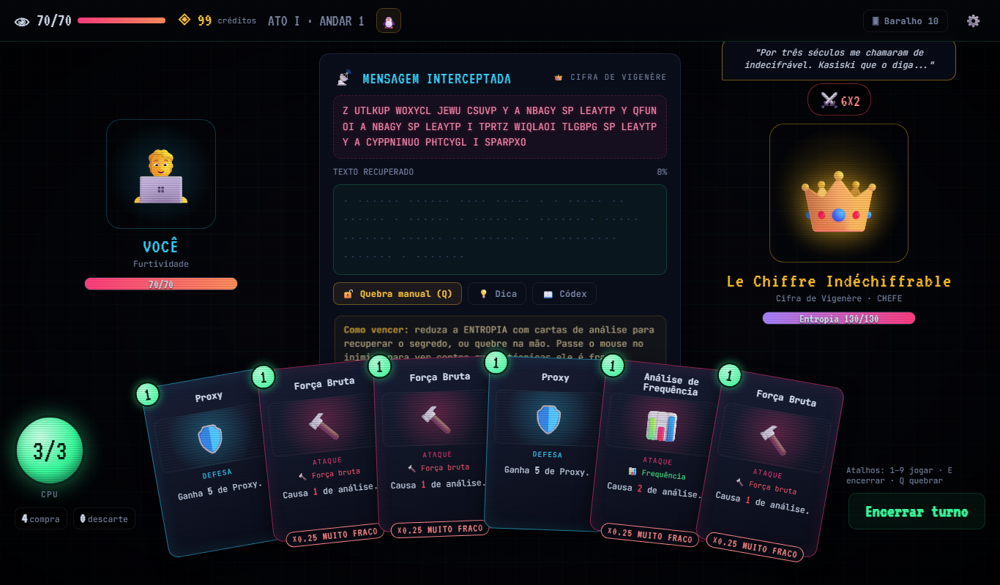
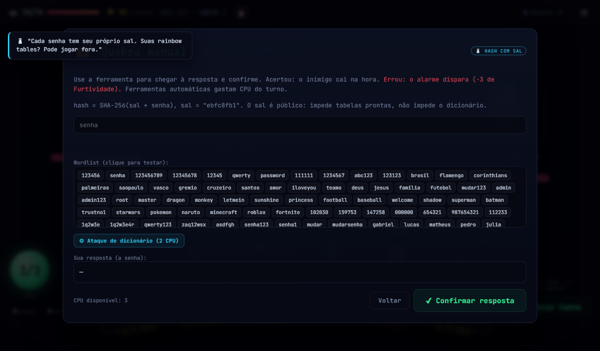
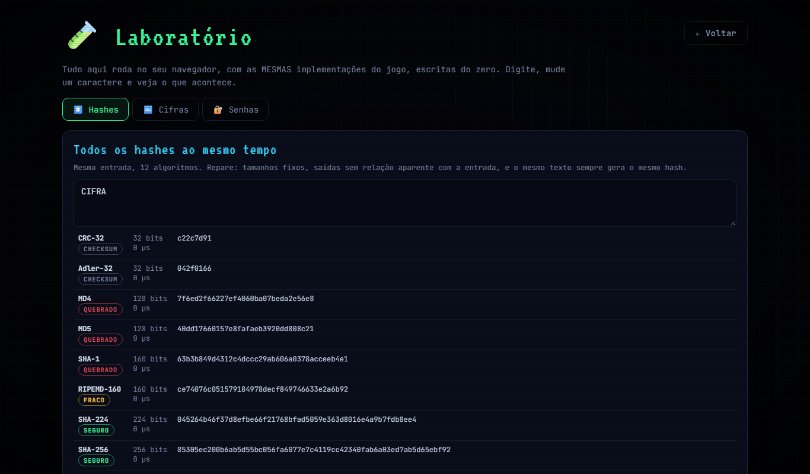

<div align="center">

# 🔐 CIFRA

**Um roguelike deckbuilder onde você aprende criptografia quebrando cifras e hashes DE VERDADE.**

Da cifra de César ao PBKDF2: cada inimigo protege um segredo real, cada carta é uma técnica real de criptoanálise,<br>
e o jogo explica **por que** cada ataque funciona (ou não).




</div>

---

## O que é

Você é um invasor descendo andar por andar de um servidor. Cada andar é uma era da criptografia:

| Ato | Tema | Inimigos | Chefe |
|---|---|---|---|
| **I — Antiguidade** | cifras clássicas | César, ROT13, Atbash, Cerca Ferroviária, Substituição | 👑 **Vigenère**, "o indecifrável" |
| **II — Bits e Bytes** | codificações e XOR | Base64, Hexadecimal, XOR de 1 byte, XOR repetido | 📒 **One-Time Pad** (imune até reutilizar a chave!) |
| **III — O Cofre de Senhas** | hashes | CRC-32, NTLM (MD4), MD5, SHA-1, PIN em SHA-256, hash com sal, PBKDF2 | 🏦 **O Cofre**, que migra de MD5 → SHA-256 com sal → PBKDF2 durante a luta |

Nada é decorável: **a cada partida as chaves e as senhas são sorteadas** e cifradas ali na hora pelas implementações do jogo.

## Como se joga

- Você tem **3 de CPU** por turno para jogar cartas. Cartas de ataque reduzem a **Entropia** do inimigo e revelam o texto secreto letra por letra.
- Cada carta usa uma **técnica**: força bruta, análise de frequência, Kasiski, texto conhecido, dicionário, rainbow table, colisão, engenharia social...
- Cada técnica é **super efetiva, fraca ou inútil** dependendo da proteção do inimigo, **e o jogo explica o motivo**:
  - Força bruta contra César: **×2**, porque *"só existem 25 chaves"*.
  - Força bruta contra substituição: **×0,1**, porque *"são 26! ≈ 4×10²⁶ chaves"*.
  - Frequência contra Vigenère: **×0,25** até você descobrir o período com o **Teste de Kasiski**, aí vira **×1,75**.
  - Rainbow table contra MD5 sem sal: **×2,5**. Contra hash com sal: **×0**.
- **🔓 Quebra manual:** a qualquer momento, abra ferramentas reais de criptoanálise e quebre o segredo com as próprias mãos. Acertou: o inimigo cai na hora. Errou: o alarme dispara.



### As ferramentas da quebra manual

| Proteção | Ferramenta |
|---|---|
| César / ROT13 | Disco de deslocamento + gráfico de frequência (cifrado × português) |
| Atbash | Alfabeto espelhado |
| Cerca ferroviária | Seletor de trilhos (e a lição de que transposição não muda a frequência) |
| Substituição | Grade letra a letra, ordenada por frequência, preenchida com o que seus ataques revelaram |
| Vigenère | Repetições de Kasiski, tamanhos de chave mais prováveis e decifração ao vivo |
| Base64 / Hex | Um botão de "decodificar", porque codificação não é criptografia |
| XOR de 1 byte | Controle de 0 a 255 com pontuação de "cara de texto" |
| XOR repetido | Gráfico da distância de Hamming por tamanho de chave |
| One-Time Pad reutilizado | **Crib dragging** sobre c₁ ⊕ c₂ |
| Hashes | Wordlist, ataque de dicionário com medição de tempo, força bruta de PIN e um visual de **efeito avalanche** bit a bit |

## Implementado do zero

Nenhuma biblioteca de criptografia: tudo em [`src/crypto`](src/crypto), em TypeScript puro e comentado, para ser lido e estudado.

| Algoritmo | Arquivo | Detalhe interessante |
|---|---|---|
| CRC-32, Adler-32 | [checksums.ts](src/crypto/hash/checksums.ts) | checksums, **não** hashes criptográficos |
| MD4, MD5 | [md.ts](src/crypto/hash/md.ts) | constantes do MD5 = ⌊\|sen(i)\| × 2³²⌋ |
| SHA-1, SHA-224, SHA-256, SHA-384, SHA-512 | [sha.ts](src/crypto/hash/sha.ts) | as constantes são **calculadas** a partir das raízes dos números primos, como manda a especificação |
| SHA3-256, SHA3-512 (Keccak) | [sha3.ts](src/crypto/hash/sha3.ts) | constantes de rodada geradas pelo LFSR |
| RIPEMD-160 | [ripemd.ts](src/crypto/hash/ripemd.ts) | duas linhas paralelas de compressão |
| HMAC, PBKDF2, NTLM | [index.ts](src/crypto/hash/index.ts) | RFC 2104 / RFC 8018 |
| César, ROT13, Atbash, Vigenère, Substituição, Cerca, XOR, Base64, Hex | [ciphers.ts](src/crypto/ciphers.ts) | |
| Análise de frequência, χ², índice de coincidência, Kasiski, Hamming | [analysis.ts](src/crypto/analysis.ts) | as mesmas usadas pelas ferramentas do jogo |

**Todos os hashes são testados contra os vetores oficiais e contra o OpenSSL do Node** em entradas de vários tamanhos, incluindo as bordas do padding (55, 56, 64, 111, 112, 135, 136 bytes...). Há ainda testes do motor (todo puzzle tem solução, o mapa é sempre conexo) e um **teste de balanceamento**: um bot enfrenta cada inimigo 40 vezes para garantir que nenhum combate fique impossível.

## Além do jogo

- **📖 Códex**: uma enciclopédia com 35 entradas (cifras, hashes, técnicas e conceitos como efeito avalanche, entropia e o Princípio de Kerckhoffs), desbloqueadas conforme você joga.
- **🧪 Laboratório**: calcule os 12 hashes ao mesmo tempo, veja o efeito avalanche bit a bit, teste HMAC, cifre e decifre com qualquer cifra, meça quanto tempo uma senha resistiria e sinta na pele a lentidão proposital do PBKDF2.
- **❓ Eventos**: quizzes como "qual algoritmo gerou este hash?", "quantos bits mudam no efeito avalanche?" e "qual senha é mais forte?" (xkcd 936).



## Rodando

Jogue direto no navegador: **https://matensy.github.io/Cifra/**, ou rode localmente:

```bash
git clone https://github.com/Matensy/Cifra.git
cd Cifra
npm install
npm run dev
```

| Comando | O que faz |
|---|---|
| `npm run dev` | servidor de desenvolvimento |
| `npm test` | testes (vetores oficiais dos hashes + motor do jogo) |
| `npm run build` | build de produção em `dist/` |

Em modo de desenvolvimento, `?enemy=<id>` (por exemplo `?enemy=vigenere`) leva direto a um combate, útil para testar cada cifra.

## Arquitetura

```
src/
  crypto/        hashes, cifras e criptoanálise — puro, sem dependências, 100% testado
  game/          motor do jogo: combate, puzzles, mapa procedural, RNG com semente
  content/       cartas, inimigos, implantes, eventos, textos e o Códex
  ui/            telas, animações, partículas e sons sintetizados (Web Audio)
tests/           vetores oficiais + testes do motor
```

O **motor de combate não conhece a tela**: ele muda o estado e emite eventos (`hit`, `block`, `phase`...), que a interface anima em sequência. Isso permite testar todas as regras sem navegador. O mapa e os sorteios usam um **RNG com semente**, então a "semente do dia" gera a mesma partida para todo mundo.

Sem framework de UI, sem imagens: arte com emoji e CSS, sons gerados na hora com osciladores.

## Licença

[MIT](LICENSE)
